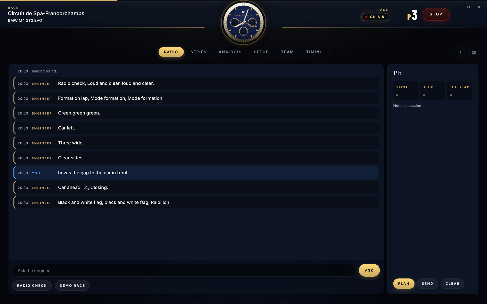
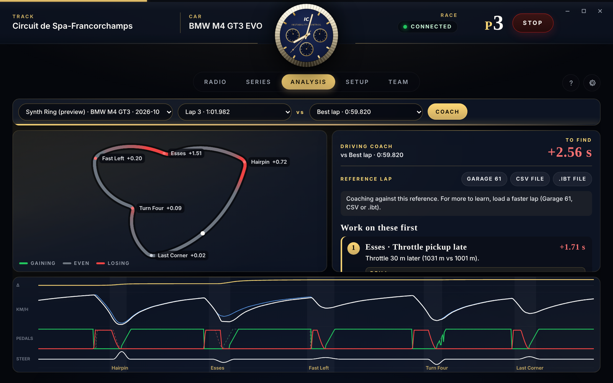
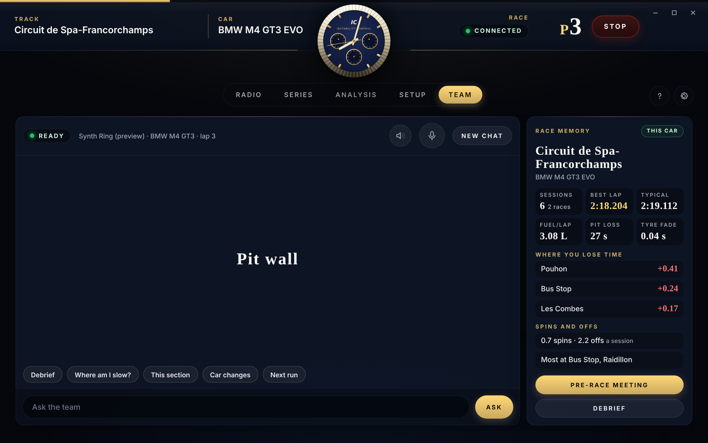
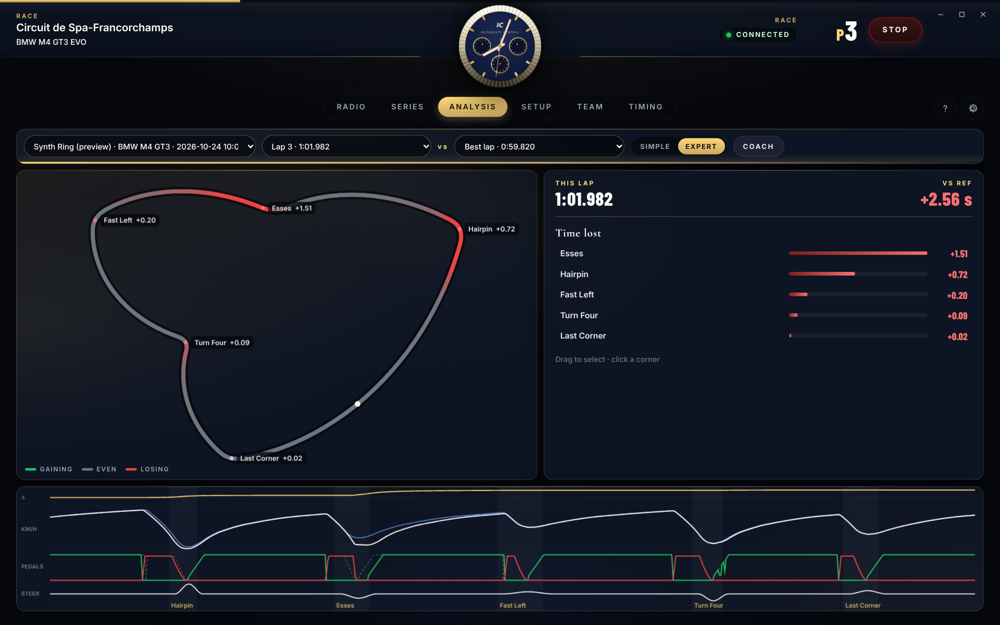
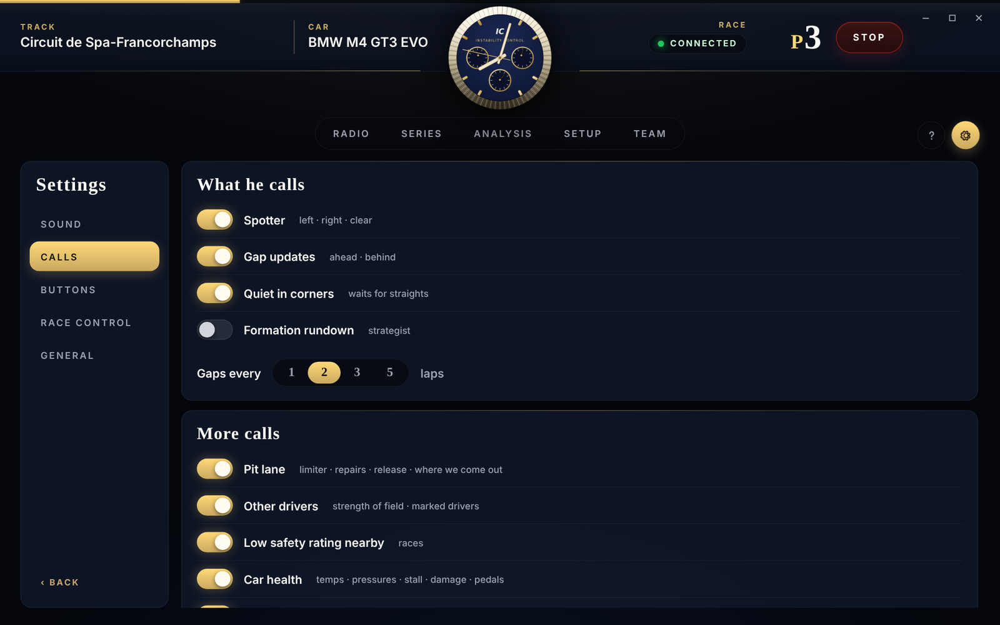
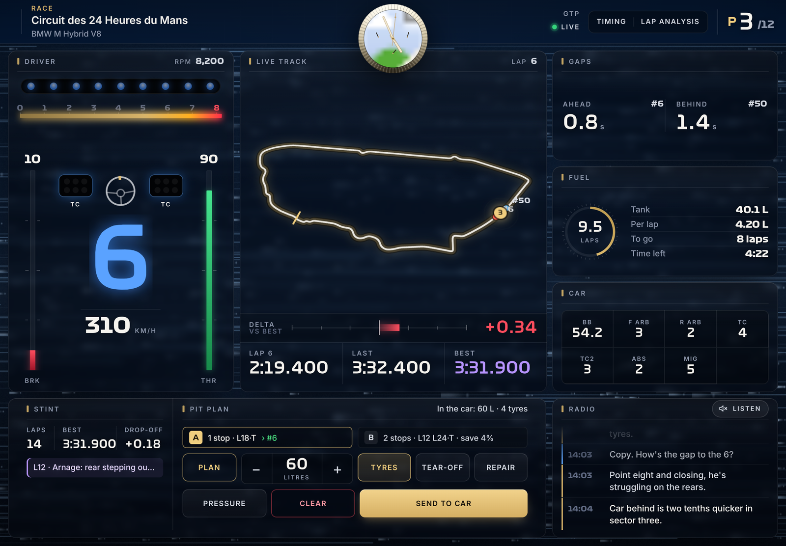
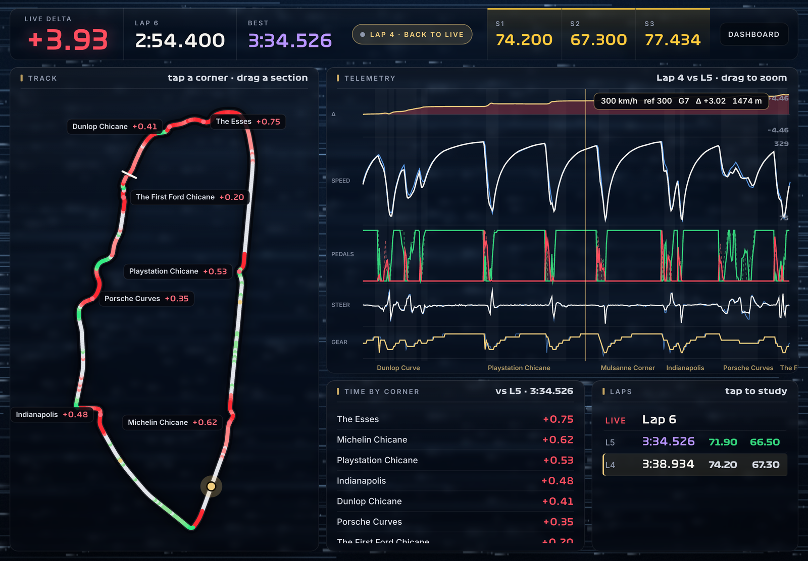

# INSTABILITY CONTROL

**A free race engineer for iRacing. She talks to you on the radio, plans your fuel, spots for you and sets up your pit stops.**

---

## Why I made this

I drive the BMW M4 GT3 and the M Hybrid V8 on iRacing. I wanted a real race team in my ear: an engineer who knows my car, a strategist who remembers what I did last time, a spotter who tells me when someone's alongside. Like a real team, not just a voice reading numbers.

There are tools that do some of this, but you pay for them. I don't like that. People who don't have the money shouldn't be at a disadvantage. So I'm building one that does more, and it's free, for everybody, forever.

> **It's in beta and it's updated frequently.** If something sounds wrong, [report it](../../issues/new/choose). That's how it gets better.

---

## Your team

| | |
|---|---|
| 🎧 **Race engineer** | Gaps, flags, fuel, lap times, track limits, pit calls. Hold the radio button and just talk to it normally, no special phrases. |
| 📋 **Strategist** | Remembers every stint and race sim you've done. Builds Plan A and Plan B, re-plans during the race, plans around rain. On the formation lap she gives you the rundown, **but only if you answer her radio check**, so nobody hears your strategy if you're streaming. |
| 🏁 **Practice run plan** | In practice she gives you a set of runs (race sim, fuel save, long run, quali sim), fuels the car for each one and tells you how it went. |
| 👀 **Spotter** | Car left, car right, clear. Pick a voice, including the CrewChief spotters if you already have CrewChief installed. |
| 🔧 **Pit crew** | Tell it what you want ("four tyres", "clear tear off", "fuel to the end") and it sets iRacing's pit menu for you. |
| 🎛️ **In-car adjustments** | Brake bias, traction control, ABS, anti-roll bars and more, by voice. It watches how you drive, spots understeer or oversteer on entry, mid-corner or exit, tells you which knob helps and what it does, and makes the change if you say "do it". |
| 🏎️ **Driving coach** | Compares your lap to a faster one (your own best, a CSV or an .ibt file), corner by corner: braking, turn-in, minimum speed, throttle, gears. Ranked by time lost, each with a plain-English fix and a drill. |
| 🧠 **Race memory** | Remembers every session per car and track: best and typical laps, fuel, tyre wear, pit loss, where you lose time, spins and offs. |
| 🗣️ **Team meetings** | A pre-race strategy meeting and a post-race debrief with your engineer and mechanic. Ask "what if it rains?" or "what if we do one stop?". The numbers come from fixed maths, never guessed. The AI team stays quiet while you're driving. |
| 🌡️ **Tyre warm-up** | Works out how long your tyres take to come in, from your own telemetry. |
| 🗺️ **Lap analysis** | Track map, theoretical best lap and a corner-by-corner breakdown of where the time is. It records its own telemetry from your drives **and your replays**, so nothing depends on other apps. |
| 📱 **iPad app** | A pit-wall screen for the tablet next to your rig: live telemetry, gaps, fuel, pit controls and the team radio (you can listen to it). Live lap analysis you drive with your finger: drag across the track or the traces to study a corner against your best. The background takes on each corner's theme as you go round. |

Only one voice talks at a time. The spotter always goes first, and nobody talks over anybody.

---

## Screenshots

| | |
|---|---|
|  **Driving coach**: where the time is and how to find it |  **Team**: race memory, meetings and debriefs |
|  **Lap analysis**: track map and traces |  **Settings**: choose what it tells you |
<!-- iPad screenshots to come (they need a live PC link to render):
|  **iPad pit wall**: everything at a glance next to the rig |  **iPad lap analysis**: drag a finger across a corner to study it |
-->

Screenshots are from the app's preview mode with sample data.

---

## Getting it

Download the latest beta from the [Releases](../../releases) page. Windows and iRacing for now. I'd love to bring it to other sims later.

## Found a problem? Got an idea?

Use [Report a problem](../../issues/new/choose). Reports come in batches and I go through them myself, so give it a bit, but I read every one.

## Why it's free

Racing should be about who's fastest, not who paid the most. If you want to help, there's a **Sponsor** button at the top (Ko-fi or PayPal). Donations don't unlock anything. Everybody gets the same app.

## Leagues, events and sponsors

Running a league or event and want a custom setup, or want to sponsor the project? [Open an issue](../../issues/new/choose) with **EVENT** or **SPONSOR** in the title.

## Also from me

**[Grandstand](https://github.com/instabilitycontrol/grandstand)** gives your iRacing races TV-style broadcast graphics. Track openers, timing tower, story cards, podium. Built in 4K and scales up to 8K and cinema screens. Also free.

## Credits

See [CREDITS.md](CREDITS.md). Not affiliated with iRacing, Garage 61 or CrewChief.
